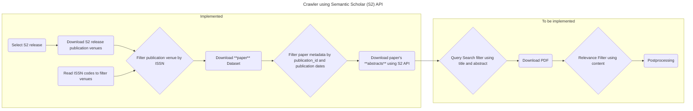

# Crawler

[](https://github.com/orgs/DFKI-NLP/projects/2)
[](https://github.com/DFKI-NLP/kibad-llm)



The crawler uses the [Datasets](https://api.semanticscholar.org/api-docs/datasets) and the [Academic Graph](https://api.semanticscholar.org/api-docs/graph) API from Semantic Scholar to query and download papers.

1. Request links for the `publication-venues` and `papers` datasets using the **Datasets API** (the `papers` dataset does not contain the abstract of the papers)
1. Query the abstracts of those papers in batches of 500 papers using the bulk entrypoint of the **Academic Graph API**.
1. Semantic Scholar API provides an `openAccessPdf.url` field with a link to the PDF file for the open access papers.

# Setup

This project requires [uv](https://docs.astral.sh/uv/). If it is not already
installed, please see the [installation guide](https://docs.astral.sh/uv/getting-started/installation/).

```bash
# clone project
git clone https://github.com/DFKI-NLP/kibad-crawler
cd kibad-crawler

# create a Python environment and install dependencies
uv sync

# (optional) copy the .env.example file to .env and adjust environment variables as needed
cp .env.example .env
```

## Prerequisites

To download the files with paper metadata, it is required:

- A SemanticScholar API key that can be requested [here](https://www.semanticscholar.org/product/api)
    - Add it to the `.env` file on this repo as `S2_API_KEY=YOURAPIKEYFROMSEMANTICSCHOLAR`.
- A CSV file with column names with the string "`ISSN`" that is used to filter papers by publication venue. The CSV file must be saved to [`./data/raw/journals.csv`](/data/raw/journals.csv)
    - The existing `journals.csv` is generated from this [spreadsheet](https://docs.google.com/spreadsheets/d/1ugPuiRNmcVYWcV98TvXsyqVwJYhmk2iZjZ4o9estM2Y/edit?gid=1647072097#gid=1647072097) that contains publication venues with their corresponding ISSN codes.

> **Note**: The `journals.csv` is currently a requisite to make the code work
> and the repository comes with this file in `./data/raw/journals.csv` with 100
> publication venues on the subject of biodiversity. This file is used to
> select specific publication venues from which papers will be checked and can
> be modified to include or remove publication venues.

# Usage

```bash
uv run kibad-crawler --help
uv run kibad-crawler list-releases
uv run kibad-crawler list-releases --top-n 15
uv run kibad-crawler download-publication-venues
uv run kibad-crawler download-publication-venues --release 2026-05-26

uv run kibad-crawler download-paper-metadata --help
```

## Download algorithm

To download new publications the process is the following:

The call `uv run kibad-crawler download-paper-metadata` triggers the following flow:

1. Download the releases and select the most recent by default. The release has a format of date `2026-02-03`.
1. Download the `publication-venues` dataset of that `release`.
1. Filter the `publication-venues` by the `ISSN` codes obtained from [journals.csv](./data/raw/journals.csv) and generate a list with specific venues.
1. Extract the `id` of those `publication-venues`.
1. Download the `papers` dataset. 60 files of 1,8GB each.
    1. Get the a list with links to all the files
    1. Download each of the links to disk
1. Select a publication date range to filter the papers.
1. Filter each batch of papers by the `venue_id` and publication date range.
    1. An additional filter by `citationCount` can be added.
1. Extract the `paperid` from the last part of the `url` field in the `papers` dataset
1. Use the list of `paperid`s to bulk query the API to download 500 papers on each call
1. The following fields are returned by the bulk API `"corpusId,url,title,abstract,venue,publicationVenue,year,citationCount,isOpenAccess,openAccessPdf,publicationDate,journal,fieldsOfStudy,s2FieldsOfStudy,authors,tldr,publicationTypes,textAvailability"`
1. The bulk of 500 papers each is stored in files with the following pattern `semantic_scholar/release/<release>/<csv_file_name_with_basic_metadata>/json/<release>-<batch_number>.json`

```python
# Extract from src/kibad-crawler/main.py::download_paper_metadata

"""Download metadata of papers from Semantic Scholar.

The resulting metadata will contain the following fields: corpusId, url,
title, abstract, venue, publicationVenue, year, citationCount, isOpenAccess,
openAccessPdf, publicationDate, journal, fieldsOfStudy, s2FieldsOfStudy,
authors, tldr, publicationTypes, textAvailability.

See the available fields in the data section of the Response Schema here:
https://api.semanticscholar.org/api-docs/graph#tag/Paper-Data/operation/get_graph_paper_bulk_search

Args:
    - file_with_issn (str): CSV file with ISSN codes of publication venues used to filter publications from those venues. Default to `str(RAW_DATA_DIR / "journals.csv"`
    - release (str): Release version from Semantic Scholar with format 'YYYY-MM-DD'. The latest release is used in case no release is provided. Default to None.
    - n_files (int): Number of 1GB compressed files with metadata of papers to download. Zero means it will download all the ~60 files available per release Defaults to 0.
    - min_publication_date (str): Minimum publiction date to search papers. Defaults to "2024-01-01".
    - max_publication_date (str): Maximum publiction date to search papers. Defaults to datetime.now().strftime("%Y-%m-%d").
    - min_citation_count (int): Minimum citation count to select a paper. Defaults to 0.
    - overwrite (bool): Whether or not to overwrite files already processed. Defaults to False.
    - persistent (bool): Whether or not to keep original 1GB files of metadata after filtering papers. Defaults to False.
"""
# (step 1) Set release_id
available_releases = datasets.get_available_releases()
release_id = release or available_releases[-1]

# (step 2) Get publication venues from the release
links_publication_venues = datasets.download_links(release_id, "publication-venues")
output_path = datasets.download_dataset_from_semantic_scholar(
    url=links_publication_venues["files"][0],
    output_path=RAW_DATA_DIR
    / "semantic_scholar"
    / "release"
    / release_id
    / "publication_venues",
)
df_venues = datasets.read_publication_venues(file_path=output_path)

# (step 3) Get publication ids from ISSN code to filter publication venues
issn = get_issn_codes(file_with_issn)

# (step 4) Extract ids from publication-venues
publication_venue_ids = df_venues[df_venues["issn"].isin(issn)].id.unique()

# (step 5) Get the links to the metadata files of the papers
links_papers = datasets.download_links(release_id=release_id, dataset_name="papers")

# (steps 6 and 7)
search_params = PaperSearch(
    publication_venue_ids=publication_venue_ids,  # type: ignore
    min_publication_date=min_publication_date,
    max_publication_date=max_publication_date,
    min_citation_count=min_citation_count,
)

# (steps 8 to 11) Downloads files with the actual metadata of the papers
output_path_papers = RAW_DATA_DIR / "semantic_scholar" / "release" / release_id / "papers"
for url in links_papers["files"][: len(links_papers) if n_files == 0 else n_files]:
    get_papers(
        url=url,
        output_path=output_path_papers,
        search_params=search_params,
        overwrite=overwrite,
        persistent=persistent,
    )
logger.info("finished successfully")
```

<!--
## S2 API client (class and methods)

The Semantic Scholar integration lives in `kibad_crawler.s2_api`. For a human-written overview of the client, diffs, recommendations, and relevance filter, see [docs/S2_CLIENT_AND_FEATURES.md](docs/S2_CLIENT_AND_FEATURES.md). You can use the **class-based client** or the existing **module-level functions** (unchanged for the notebook):

```python
from kibad_crawler import S2Client

client = S2Client()  # uses S2_API_KEY from env

# Releases and incremental diff (last two releases)
releases = client.get_releases()
paths = client.download_last_two_releases_diff(dataset_name="papers")
# Diffs are stored under: data/raw/semantic_scholar/release/<to_release>/diffs/<from>_to_<to>/

# Recommendations API (paper-based)
recs = client.get_recommendations_for_paper("PAPER_ID_HERE", limit=10)
# recs is RecommendationsResponse with recs.recommendations

# Relevance filter (additional input: citations, venue, fields of study, keywords)
from kibad_crawler import RelevanceFilter

criteria = RelevanceFilter(min_citation_count=5, keywords=["NLP", "transformer"])
papers = [...]  # list of paper dicts from bulk API
filtered = client.filter_by_relevance(papers, criteria)
``` -->

# Resources

- [Semantic Scholar API - Overview](https://www.semanticscholar.org/product/api)
- [Semantic Scholar API - Docs](https://api.semanticscholar.org/api-docs/)
- [API Tutorial](https://www.semanticscholar.org/product/api/tutorial)
- [full-dataset.py](https://github.com/allenai/s2-folks/blob/main/examples/python/s2ag_datasets/full-datasets.py) example
- [How to download full datasets](https://www.semanticscholar.org/product/api/tutorial#download-full-datasets)

# Contributing

For project development and contribution guidelines, please refer to [CONTRIBUTING.md](/docs/CONTRIBUTING.md).
