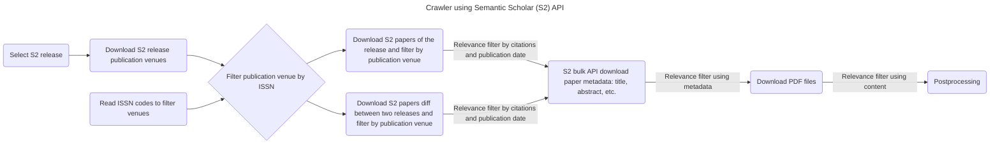

# Crawler

[](https://github.com/orgs/DFKI-NLP/projects/2)
[](https://github.com/DFKI-NLP/kibad-llm)

The crawler uses Semantic Scholar API to query and download papers. It is a two
step process:

1. Request the links of a dataset (publication venues, abstracts, papers, etc.). The links have an expiration date.
1. Download the files using the links before the expiration date.

# Setup

This project requires [uv](https://docs.astral.sh/uv/). If it is not already
installed, please see the [installation guide](https://docs.astral.sh/uv/getting-started/installation/).

```bash
# clone project
git clone https://github.com/DFKI-NLP/kibad-crawler
cd kibad-crawler

# create a Python environment and install dependencies
uv sync

# (optional) copy the .env.example file to .env and adjust environment variables as needed
cp .env.example .env
```

To download additional papers it is required:

- A SemanticScholar API key that can be requested [here](https://www.semanticscholar.org/product/api)
    - Add it to the `.env` file on this repo as `S2_API_KEY=YOURAPIKEYFROMSEMANTICSCHOLAR`.
- A copy in CSV of the file [Übersicht relevante Journals und Archive](https://docs.google.com/spreadsheets/d/1ugPuiRNmcVYWcV98TvXsyqVwJYhmk2iZjZ4o9estM2Y/edit?gid=1647072097#gid=1647072097)
    - Store the CSV file in `./data/raw/journals.csv`

# Usage

```bash
uv run src/kibad_crawler/main.py list-releases --top-n 10

uv run src/kibad_crawler/main.py download-publication-venues

uv run src/kibad_crawler/main.py download-papers "FILEPATHTOJOURNALSWITHISSNCODES.csv" --n-files 1
```

```bash
uv run kibad-crawler --help
uv run kibad-crawler list-releases
uv run kibad-crawler list-releases --top-n 15
uv run kibad-crawler download-publication-venues
uv run kibad-crawler download-publication-venues --release 2026-05-26

uv run kibad-crawler download-paper-metadata --help
```




<!--
## S2 API client (class and methods)

The Semantic Scholar integration lives in `kibad_crawler.s2_api`. For a human-written overview of the client, diffs, recommendations, and relevance filter, see [docs/S2_CLIENT_AND_FEATURES.md](docs/S2_CLIENT_AND_FEATURES.md). You can use the **class-based client** or the existing **module-level functions** (unchanged for the notebook):

```python
from kibad_crawler import S2Client

client = S2Client()  # uses S2_API_KEY from env

# Releases and incremental diff (last two releases)
releases = client.get_releases()
paths = client.download_last_two_releases_diff(dataset_name="papers")
# Diffs are stored under: data/raw/semantic_scholar/release/<to_release>/diffs/<from>_to_<to>/

# Recommendations API (paper-based)
recs = client.get_recommendations_for_paper("PAPER_ID_HERE", limit=10)
# recs is RecommendationsResponse with recs.recommendations

# Relevance filter (additional input: citations, venue, fields of study, keywords)
from kibad_crawler import RelevanceFilter

criteria = RelevanceFilter(min_citation_count=5, keywords=["NLP", "transformer"])
papers = [...]  # list of paper dicts from bulk API
filtered = client.filter_by_relevance(papers, criteria)
``` -->

# 1. Übersicht relevante Journals und Archive

The first task is to find the ISSN code for all the journals in
`Übersicht relevante Journals und Archive.csv` in the columns `Online ISSN` and
`Print ISSN`.

# 2. Semantic Scholar

## Data

Semantic Scholar has the concept of `release` (i.e.: '2025-12-02', '2025-12-09',
'2026-01-20', '2026-01-27'). There are over 170 releases currently, the first
one is from: '2022-05-10'. Each release contains all the papers until the
requested date, so it is necessary to filter them by publication date and
publication venue.

Each `release`, has the following datasets:

- `publication-venues` Details about the venues in which papers are published.
    ~200k publication venues in the dataset.
- `papers` The core attributes of a paper (title, authors, date, etc.). 200M
    records in 30 1.5GB files.
- `abstracts`: Paper abstract text, where available. 100M records in 30 1.8GB
    files.
- `authors`: The core attributes of an author (name, affiliation, paper count,
    etc.). Authors have an "authorId" field, which can be joined to the
    "authorId" field of the members of a paper's "authors" field. 75M records in
    30 100MB files.
- `citations` Instances where the bibliography of one paper (the "citingPaper")
    mentions another paper (the "citedPaper"), where both papers are identified
    by the "paperId" field. Citations have attributes of their own, (influential
    classification, intent classification, and citation context). 2.4B records in
    30 8.5GB files.
- `embeddings-specter_v1` A dense vector embedding representing the contents of
    the paper. 120M records in 30 28GB files.
- `embeddings-specter_v2` A dense vector embedding representing the contents of
    the paper, generated with SPECTER2 120M records in 30 28GB files.
- `paper-ids` Mapping from sha-based ID to paper corpus ID. 450M records in 30
    500MB files
- `s2orc` Full-body paper text parsed from open-access PDFs. Identifies
    structural elements such as paragraphs, sections, and bibliography entries.
    10M records in 30 4GB files.
- `s2orc_v2` Full-body paper text parsed from open-access PDFs. Identifies
    structural elements such as sentences and paragraphs, and bibliographic
    references. 16M records in 30 6GB files.
- `tldrs` A short natural-language summary of the contents of a paper. 58M
    records in 30 200MB files.

## Download algorithm

To download new publications the process is the following:

1. Download the releases and select the most recent by default. The release has a format of date `2026-02-03`.
1. Download the `publication-venues` dataset of that `release`.
1. Filter the `publication-venues` by the `ISSN` codes obtained from [Übersicht relevante Journals und Archive](https://docs.google.com/spreadsheets/d/1ugPuiRNmcVYWcV98TvXsyqVwJYhmk2iZjZ4o9estM2Y/edit?gid=1647072097#gid=1647072097) and generate a list with specific venues.
1. Extract the `id` of those `publication-venues`.
1. Download the `papers` dataset. 60 files of 1,8GB each.
1. Select a publication date range to filter the papers.
1. Filter each batch of papers by the `venue_id` and publication date range.
    1. An additional filter by `citationCount` can be added.
1. Extract the `paperid` from the last part of the `url` field in the `papers` dataset
1. Use the list of `paperid`s to bulk query the API to download 500 papers on each call
1. The following fields are returned by the bulk API `"corpusId,url,title,abstract,venue,publicationVenue,year,citationCount,isOpenAccess,openAccessPdf,publicationDate,journal,fieldsOfStudy,s2FieldsOfStudy,authors,tldr,publicationTypes,textAvailability"`
1. The bulk of 500 papers each is stored in files with the following pattern `semantic_scholar/release/<release>/json/<release>-<batch_number>.json`

# Resources

- [Semantic Scholar API - Overview](https://www.semanticscholar.org/product/api)
- [Semantic Scholar API - Docs](https://api.semanticscholar.org/api-docs/)
- [API Tutorial](https://www.semanticscholar.org/product/api/tutorial)
- [full-dataset.py](https://github.com/allenai/s2-folks/blob/main/examples/python/s2ag_datasets/full-datasets.py) example
- [How to download full datasets](https://www.semanticscholar.org/product/api/tutorial#download-full-datasets)

# Contributing

For project development and contribution guidelines, please refer to [CONTRIBUTING.md](/docs/CONTRIBUTING.md).
