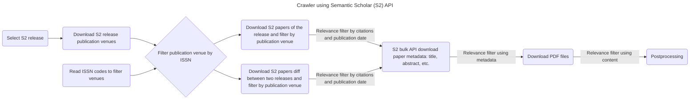

# Crawler

[](https://github.com/orgs/DFKI-NLP/projects/2)
[](https://github.com/DFKI-NLP/kibad-llm)



The crawler uses Semantic Scholar API to query and download papers. It is a two
step process:

1. Request the links of a dataset (publication venues, abstracts, papers, etc.). The links have an expiration date.
1. Download the files using the links before the expiration date.

# Setup

This project requires [uv](https://docs.astral.sh/uv/). If it is not already
installed, please see the [installation guide](https://docs.astral.sh/uv/getting-started/installation/).

```bash
# clone project
git clone https://github.com/DFKI-NLP/kibad-crawler
cd kibad-crawler

# create a Python environment and install dependencies
uv sync

# (optional) copy the .env.example file to .env and adjust environment variables as needed
cp .env.example .env
```

## Prerequisites

To download additional papers it is required:

- A SemanticScholar API key that can be requested [here](https://www.semanticscholar.org/product/api)
    - Add it to the `.env` file on this repo as `S2_API_KEY=YOURAPIKEYFROMSEMANTICSCHOLAR`.
- A copy in CSV of the file [Übersicht relevante Journals und Archive](https://docs.google.com/spreadsheets/d/1ugPuiRNmcVYWcV98TvXsyqVwJYhmk2iZjZ4o9estM2Y/edit?gid=1647072097#gid=1647072097)
    - Store the CSV file in `./data/raw/journals.csv`

# Usage

```bash
uv run src/kibad_crawler/main.py list-releases --top-n 10

uv run src/kibad_crawler/main.py download-publication-venues

uv run src/kibad_crawler/main.py download-papers "FILEPATHTOJOURNALSWITHISSNCODES.csv" --n-files 1
```

```bash
uv run kibad-crawler --help
uv run kibad-crawler list-releases
uv run kibad-crawler list-releases --top-n 15
uv run kibad-crawler download-publication-venues
uv run kibad-crawler download-publication-venues --release 2026-05-26

uv run kibad-crawler download-paper-metadata --help
```


<!--
## S2 API client (class and methods)

The Semantic Scholar integration lives in `kibad_crawler.s2_api`. For a human-written overview of the client, diffs, recommendations, and relevance filter, see [docs/S2_CLIENT_AND_FEATURES.md](docs/S2_CLIENT_AND_FEATURES.md). You can use the **class-based client** or the existing **module-level functions** (unchanged for the notebook):

```python
from kibad_crawler import S2Client

client = S2Client()  # uses S2_API_KEY from env

# Releases and incremental diff (last two releases)
releases = client.get_releases()
paths = client.download_last_two_releases_diff(dataset_name="papers")
# Diffs are stored under: data/raw/semantic_scholar/release/<to_release>/diffs/<from>_to_<to>/

# Recommendations API (paper-based)
recs = client.get_recommendations_for_paper("PAPER_ID_HERE", limit=10)
# recs is RecommendationsResponse with recs.recommendations

# Relevance filter (additional input: citations, venue, fields of study, keywords)
from kibad_crawler import RelevanceFilter

criteria = RelevanceFilter(min_citation_count=5, keywords=["NLP", "transformer"])
papers = [...]  # list of paper dicts from bulk API
filtered = client.filter_by_relevance(papers, criteria)
``` -->

# Resources

- [Semantic Scholar API - Overview](https://www.semanticscholar.org/product/api)
- [Semantic Scholar API - Docs](https://api.semanticscholar.org/api-docs/)
- [API Tutorial](https://www.semanticscholar.org/product/api/tutorial)
- [full-dataset.py](https://github.com/allenai/s2-folks/blob/main/examples/python/s2ag_datasets/full-datasets.py) example
- [How to download full datasets](https://www.semanticscholar.org/product/api/tutorial#download-full-datasets)

# Contributing

For project development and contribution guidelines, please refer to [CONTRIBUTING.md](/docs/CONTRIBUTING.md).
