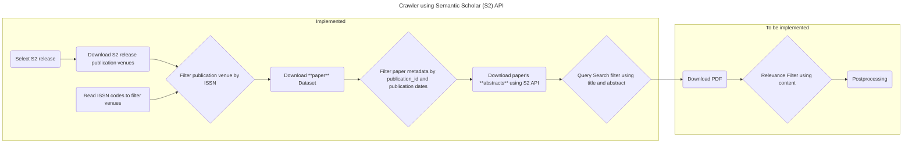

# Crawler

[](https://github.com/orgs/DFKI-NLP/projects/2)
[](https://github.com/DFKI-NLP/kibad-llm)



The crawler uses the [Datasets](https://api.semanticscholar.org/api-docs/datasets) and the [Academic Graph](https://api.semanticscholar.org/api-docs/graph) API from Semantic Scholar to query and download papers.

1. Request links for the `publication-venues` and `papers` datasets using the **Datasets API** (the `papers` dataset does not contain the abstract of the papers)
1. Query the abstracts of those papers in batches of 500 papers using the bulk entrypoint of the **Academic Graph API**.
1. Semantic Scholar API provides an `openAccessPdf.url` field with a link to the PDF file for the open access papers.

# Setup

This project requires [uv](https://docs.astral.sh/uv/). If it is not already
installed, please see the [installation guide](https://docs.astral.sh/uv/getting-started/installation/).

```bash
# clone project
git clone https://github.com/DFKI-NLP/kibad-crawler
cd kibad-crawler

# create a Python environment and install dependencies
uv sync

# (optional) copy the .env.example file to .env and adjust environment variables as needed
cp .env.example .env
```

## Prerequisites

To download the files with paper metadata, it is required:

- A SemanticScholar API key that can be requested [here](https://www.semanticscholar.org/product/api)
    - Add it to the `.env` file on this repo as `S2_API_KEY=YOURAPIKEYFROMSEMANTICSCHOLAR`.
    - The key is required to get the download links of the datasets, i.e. for `download-publication-venues` and `download-paper-metadata`. Without a valid key the API answers `401 {"error":"A valid API key is required"}`. Listing the releases and the metadata requests to the Academic Graph API work without a key.
- A CSV file with column names with the string "`ISSN`" that is used to filter papers by publication venue. The CSV file must be saved to [`./data/raw/journals.csv`](/data/raw/journals.csv)
    - The existing `journals.csv` is generated from this [spreadsheet](https://docs.google.com/spreadsheets/d/1ugPuiRNmcVYWcV98TvXsyqVwJYhmk2iZjZ4o9estM2Y/edit?gid=1647072097#gid=1647072097) that contains publication venues with their corresponding ISSN codes.

> **Note**: The `journals.csv` is currently a requisite to make the code work
> and the repository comes with this file in `./data/raw/journals.csv` with 100
> publication venues on the subject of biodiversity. This file is used to
> select specific publication venues from which papers will be checked and can
> be modified to include or remove publication venues.

> **Note**: On a cluster, the commands have to run on a compute node, e.g. with
> `srun`. The pinned numpy version requires a CPU with the x86-64-v2 instruction
> set, which the login nodes of Pegasus do not provide (`NumPy was built with baseline optimizations: (X86_V2) but your machine doesn't support: (X86_V2)`).

# Usage

```bash
uv run kibad-crawler --help
uv run kibad-crawler list-releases
uv run kibad-crawler list-releases --top-n 15
uv run kibad-crawler download-publication-venues
uv run kibad-crawler download-publication-venues --release 2026-05-26

uv run kibad-crawler download-paper-metadata --help

uv run kibad-crawler download-paper-metadata-diff --help
uv run kibad-crawler download-paper-metadata-diff --start-release 2026-09-01

uv run kibad-crawler run-string-searches --help
uv run kibad-crawler run-string-searches --method sifts
uv run kibad-crawler run-string-searches --method plain

uv run kibad-crawler string-search-info --help
uv run kibad-crawler string-search-info
```

## Download algorithm

To download new publications the process is the following:

The call `uv run kibad-crawler download-paper-metadata` triggers the following flow:

1. Download the releases and select the most recent by default. The release has a format of date `2026-02-03`.
1. Download the `publication-venues` dataset of that `release`.
1. Filter the `publication-venues` by the `ISSN` codes obtained from [journals.csv](./data/raw/journals.csv) and generate a list with specific venues.
1. Extract the `id` of those `publication-venues`.
1. Download the `papers` dataset. 60 files of 1,8GB each.
    1. Get the a list with links to all the files
    1. Download each of the links to disk
1. Select a publication date range to filter the papers.
1. Filter each batch of papers by the `venue_id` and publication date range.
    1. An additional filter by `citationCount` can be added.
1. Extract the `paperid` from the last part of the `url` field in the `papers` dataset
1. Use the list of `paperid`s to bulk query the API to download 500 papers on each call
1. The following fields are returned by the bulk API `"corpusId,url,title,abstract,venue,publicationVenue,year,citationCount,isOpenAccess,openAccessPdf,publicationDate,journal,fieldsOfStudy,s2FieldsOfStudy,authors,tldr,publicationTypes,textAvailability"`
1. The bulk of 500 papers each is stored in files with the following pattern `semantic_scholar/release/<release>/<csv_file_name_with_basic_metadata>/json/<release>-<batch_number>.json`

```python
# Extract from src/kibad-crawler/main.py::download_paper_metadata

"""Download metadata of papers from Semantic Scholar.

The resulting metadata will contain the following fields: corpusId, url,
title, abstract, venue, publicationVenue, year, citationCount, isOpenAccess,
openAccessPdf, publicationDate, journal, fieldsOfStudy, s2FieldsOfStudy,
authors, tldr, publicationTypes, textAvailability.

See the available fields in the data section of the Response Schema here:
https://api.semanticscholar.org/api-docs/graph#tag/Paper-Data/operation/get_graph_paper_bulk_search

Args:
    - file_with_issn (str): CSV file with ISSN codes of publication venues used to filter publications from those venues. Default to `str(RAW_DATA_DIR / "journals.csv"`
    - release (str): Release version from Semantic Scholar with format 'YYYY-MM-DD'. The latest release is used in case no release is provided. Default to None.
    - n_files (int): Number of 1GB compressed files with metadata of papers to download. Zero means it will download all the ~60 files available per release Defaults to 0.
    - min_publication_date (str): Minimum publiction date to search papers. Defaults to "2024-01-01".
    - max_publication_date (str): Maximum publiction date to search papers. Defaults to datetime.now().strftime("%Y-%m-%d").
    - min_citation_count (int): Minimum citation count to select a paper. Defaults to 0.
    - overwrite (bool): Whether or not to overwrite files already processed. Defaults to False.
    - persistent (bool): Whether or not to keep original 1GB files of metadata after filtering papers. Defaults to False.
"""
# (step 1) Set release_id
available_releases = datasets.get_available_releases()
release_id = release or available_releases[-1]

# (steps 2 to 4) Get publication venue ids of the release from the ISSN codes
publication_venue_ids = get_publication_venue_ids(
    release_id=release_id, file_with_issn=file_with_issn
)

# (steps 6 and 7)
search_params = PaperSearch(
    publication_venue_ids=publication_venue_ids,
    min_publication_date=min_publication_date,
    max_publication_date=max_publication_date,
    min_citation_count=min_citation_count,
)

# (step 5) Get the names of the metadata files of the papers
file_names = sorted(
    datasets.download_links_by_file_name(release_id=release_id, dataset_name="papers")
)
if n_files != 0:
    file_names = file_names[:n_files]

def get_url(file_name: str) -> str:
    """Returns the current download link of a file of the release."""
    links = datasets.download_links_by_file_name(release_id=release_id, dataset_name="papers")
    return links[file_name]

# (steps 8 to 11) Downloads files with the actual metadata of the papers
get_papers_from_files(
    file_names=file_names,
    get_url=get_url,
    output_path=RAW_DATA_DIR / "semantic_scholar" / "release" / release_id / "papers",
    search_params=search_params,
    overwrite=overwrite,
    persistent=persistent,
)
logger.info("finished successfully")
```

### How the files are downloaded and filtered

**A paper belongs to a publication venue by its id.** The crawler reads the
ISSN codes of the CSV file, looks up the matching publication venues of the
release and keeps a paper when its `publicationvenueid` is one of them. The
dataset files are read line by line, so the number of venues does not change
the speed and a 1 GB file is never held in memory.

**A download link is a short lived credential, a file name is not.** The links
of a release are pre-signed and stop working after a few hours, which is less
than a run over all files of a release takes. The files are therefore addressed
by their name, and the link of a file is requested right before the file is
downloaded. The links of the release are requested again for every file, which
is one request per file next to about 5,000 requests for the metadata.

**A file on disk is a complete file.** A download is written to a file with the
suffix `.tmp` that is renamed when it finished, and removed when it failed, so
an interrupted download leaves nothing behind that a later run would reuse. The
same applies to the JSON files with the metadata.

**A repeated run continues where it stopped.** A paper dataset file whose CSV
exists is not downloaded and not filtered again, and a batch of metadata whose
JSON file exists is not requested again. Use `--overwrite` to download and
request everything again, for example to update the citation counts of papers
that are already stored.

> **Note**: The option `--persistent` keeps the downloaded dataset files, about
> 50 GB for a release, so that the papers can be filtered again with other
> search criteria without downloading them again.

## Download papers between releases

Semantic Scholar publishes a new release about every week. Instead of processing all the files of a new release again, the call `uv run kibad-crawler download-paper-metadata-diff --start-release <release>` uses the [incremental diffs](https://api.semanticscholar.org/api-docs/datasets) between two releases:

1. Get the diffs between `--start-release` (a release that is already downloaded) and `--end-release` (the latest release by default). Each diff covers two consecutive releases and contains `update_files` (new or changed papers) and `delete_files` (removed papers).
1. Get the publication venue ids of the end release from the `ISSN` codes, as in the full download.
1. Filter the `update_files` of each diff with the same functions as `download-paper-metadata` (venue, publication date and citation count) and download the metadata of the matching papers, including abstracts.

The results of each diff are stored in their own folder with the same structure as the full download: `semantic_scholar/release/<to_release>/diffs/<from_release>_to_<to_release>/papers/`.

### Why it works like this

- **Why diffs:** Each release is a full snapshot of all papers. Processing all files of release `2026-09-01` took about 7 hours on the cluster ([#14](https://github.com/DFKI-NLP/kibad-crawler/issues/14)). A diff only contains the papers that changed between two releases, so regular updates need less time and download.
- **Why the same functions:** The `update_files` of a diff have the same format as the files of a full release. Only the list of files is different, so both calls use `get_publication_venue_ids` and `get_papers_from_files` from `papers.py`. A change in the filtering applies to both calls.
- **Why a separate folder per diff:** The data of the full release stays unchanged, and each folder shows which papers came with which diff. A diff can be processed again or removed without touching the rest.
- **Why `delete_files` are not applied:** Applying them means merging the diffs into the data of the full release. This is left for later (see "Handle paper updates" in [#3](https://github.com/DFKI-NLP/kibad-crawler/issues/3)). For now, the number of delete files is written to the log.
- **Why changed papers are saved again:** For the same reason, a paper that changed (e.g. a new citation count) is saved again in the diff folder instead of replacing the version from the full release.

## Keyword string queries

Keyword search queries are used to filter the papers by title and abstract.

The keyword searches are defined in [`search_queries.py`](./src/kibad_crawler/search_queries.py)
and more documentation can be found in [`docs/SEARCH_QUERIES.md`](./docs/SEARCH_QUERIES.md).

```bash
uv run kibad-crawler run-string-searches
```

`run-string-searches` will execute all the string searches available in the
`search_queries.py` module. The results (paper selection based on keyword
searches) are saved to `INTERIM_DATA_DIR/semantic_scholar/release/<YYYY-MM-DD>/papers/<method>`.

The workflow is as follows:

1. Given a release, it searches the paper metadata downloaded based on
    publication venues, publication dates, and citation count.
1. Using all the search queries defined in `search_queries.py` it applies
    one by one to each paper.
1. Save the papers's metadata results to
    `INTERIM_DATA_DIR/semantic_scholar/release/<YYYY-MM-DD>/papers/<method>`
    by query, with file names such as: `Q1 - Forest - Trends.json`,
    `Q2 - Forest - Drivers.json`, `Q3 - Forest - Measures.json`,
    `Q4 - Forest - Ecosystem Services.json`, etc.

Two methods to run the query searches. Defaults to `sifts`.

- `sifts`: implements keyword searches with SQLite FTS5 that handles special
    characters.
- `plain`: that is an ad-hoc implementation that checks for the appearance
    of the keywords in the paper metadata, ignoring special characters.

Use `uv run kibad-crawler string-search-info` to get an overview of the queries.

The search queries are composed by keywords and logical operators representing
six Habitats: "Forest", "Soil", "Agricultural and Open Land", "Inland waters
& Floodplains", and "Coasts & Coastal Waters"; and four Topic Areas:
"Trends", "Drivers", "Measures", and "Ecosystem Services".

For example, a search query to filter by trends in forest habitats in Germany would be:

`("species richness" OR "species abundance") AND ("German*" OR "Lower Saxony") AND ("Forest*" OR "wood*") AND ("trend*" OR "decrease*" OR "gain*)`

> [!NOTE]
> Real search queries extend beyond two words per concept.

> [!NOTE]
> Queries are pre-defined and cannot be modified by a user.

<!--
## S2 API client (class and methods)

The Semantic Scholar integration lives in `kibad_crawler.s2_api`. For a human-written overview of the client, diffs, recommendations, and relevance filter, see [docs/S2_CLIENT_AND_FEATURES.md](docs/S2_CLIENT_AND_FEATURES.md). You can use the **class-based client** or the existing **module-level functions** (unchanged for the notebook):

```python
from kibad_crawler import S2Client

client = S2Client()  # uses S2_API_KEY from env

# Releases and incremental diff (last two releases)
releases = client.get_releases()
paths = client.download_last_two_releases_diff(dataset_name="papers")
# Diffs are stored under: data/raw/semantic_scholar/release/<to_release>/diffs/<from>_to_<to>/

# Recommendations API (paper-based)
recs = client.get_recommendations_for_paper("PAPER_ID_HERE", limit=10)
# recs is RecommendationsResponse with recs.recommendations

# Relevance filter (additional input: citations, venue, fields of study, keywords)
from kibad_crawler import RelevanceFilter

criteria = RelevanceFilter(min_citation_count=5, keywords=["NLP", "transformer"])
papers = [...]  # list of paper dicts from bulk API
filtered = client.filter_by_relevance(papers, criteria)
``` -->

# Docker

```bash
# Remove and build a new Docker image
docker rmi $(docker images kibad/crawler:1.0 -q) \
&& docker build -t kibad/crawler:1.0 .

# Start a new container that can run CLI commands
docker run --name crawler \
    -itd \
    -v ./data:/opt/kibad-crawler/data \
    kibad/crawler:1.0

# Log in to the container
docker exec -it crawler bash

# Start an ephimeral container to list releases
docker run \
    -it \
    --rm \
    --name crawler \
    kibad/crawler:1.0 bash -c 'uv run kibad-crawler list-releases'

# Start an ephimeral container to download publication venues
docker run \
    -it \
    --rm \
    --name crawler \
    -v ./data:/opt/kibad-crawler/data \
    -e S2_API_KEY='SEMANTIC_SCHOLAR_API_KEY' \
    kibad/crawler:1.0 bash -c 'uv run kibad-crawler download-publication-venues'

# Start an ephimeral container to download paper's metadata
docker run \
    -it \
    --rm \
    --name crawler \
    -v ./data:/opt/kibad-crawler/data \
    -e S2_API_KEY='SEMANTIC_SCHOLAR_API_KEY' \
    kibad/crawler:1.0 bash -c 'uv run kibad-crawler download-paper-metadata'

# Start an ephimeral container to filter paper's metadata based on keyword searches
docker run \
    -it \
    --rm \
    --name crawler \
    -v ./data:/opt/kibad-crawler/data \
    -e S2_API_KEY='SEMANTIC_SCHOLAR_API_KEY' \
    kibad/crawler:1.0 bash -c 'uv run kibad-crawler run-string-searches'
```

# Resources

- [Semantic Scholar API - Overview](https://www.semanticscholar.org/product/api)
- [Semantic Scholar API - Docs](https://api.semanticscholar.org/api-docs/)
- [API Tutorial](https://www.semanticscholar.org/product/api/tutorial)
- [full-dataset.py](https://github.com/allenai/s2-folks/blob/main/examples/python/s2ag_datasets/full-datasets.py) example
- [How to download full datasets](https://www.semanticscholar.org/product/api/tutorial#download-full-datasets)

# Contributing

For project development and contribution guidelines, please refer to [CONTRIBUTING.md](/docs/CONTRIBUTING.md).
